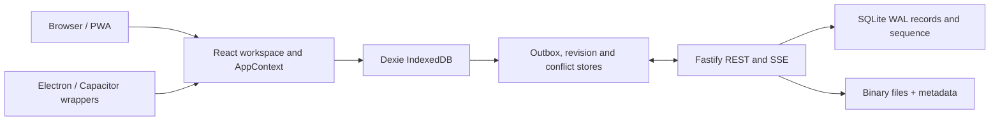

# Architecture and code quality

The client entry point is `src/main.tsx`, the route switch is in `src/App.tsx`, and `public/sw.js` controls offline caching. Server boot is `server/index.ts`. The Electron wrapper is `desktop/main.cjs` and Android is generated by the build workflow using `capacitor.config.json`. TypeScript, React/Vite, Dexie, Fastify, node:sqlite and fflate make the base easy to inspect. Docker and a separate GHCR publish workflow handle image delivery.

## Code review findings

| Area | Structure now | Development consequence |
|---|---|---|
| Canonical local records | `src/core/types.ts`, `db.ts` and `repository.ts` unify IDs, timestamps, payloads, history and deletion. Most feature records are discriminated by kind but use loosely typed JSON payloads. | Preserve IDs and allow backward reads. Add versioned per-kind schemas and default/validation migrations. Separate immutable event history from mutable record state where traceability matters. |
| Durable domain writes | Repository mutators write records, history and sync records independently. Several feature handlers compose multiple writes. | Write domain commands and membership/reference changes in a single transaction. Test concurrent edits, restart boundary failures and multi-record write recovery. |
| Shared reads and navigation | `AppContext.tsx:354–372` observes all records and derives active profile/workspace arrays. The context also owns timers, notifications, sync, navigation and shortcuts. | Narrow subscriptions by indexed workspace/type and split service state providers. Keep shared views of the same record. |
| View complexity | Largest files by nonblank source-line count include FlowCalendar (2,207), TodaySpread (1,779), TimeSuite (1,586), Settings (1,530), Notes (1,448) and LabWorkspace (1,445). | Extract state transitions and domain operations around tested workflows, then migrate shared form components. Avoid a wholesale rewrite. |
| Search and relationships | `search.ts:51–148` extracts a fixed field list, scans known records and sorts results. Features store a mix of IDs, labels and snapshots. | Adopt typed relation edges with ownership, cardinality and delete policies. Build an incremental index and unified record deep links over canonical IDs. |
| Attachments | `db.ts:507–533` stores hashed originals and thumbnails. Server has binary routes separate from delta records. | Establish attachment metadata, references, readiness and retries as first-class sync data. Keep deduplication and restore references. |
| Large documents and sheets | Notes edits write full content, large spreads use DOM/SVG and the worksheet evaluator binds a whole workbook per reaction. | Start with instrumentation and segmentation based on measured latency, then benchmark incremental parse, virtualized sheets and bounded rendering. |
| Package reproducibility | Docker builds allow `npm ci || npm install`. Android installs plugin dependencies at workflow time and builds debug APK. Electron dependencies have no tracked lock. Running tests is absent from packaging and publish workflows. | Require reproducible artifact inputs, test-first CI and a consistent release version manifest. Native install/upgrade needs a separate test gate. |
| Observability | Fastify logger is disabled and multiple nonfatal handlers swallow errors. Snapshot reports can omit WAL size. | Add privacy-preserving operational events, backup and retry status, log hygiene, and storage accounting across database, WAL and blob artifacts. |
| Architecture direction | One local-first product with personal and professional views. | Use domain modules and explicit permissions, plus a coordinated sync protocol. Start with one server process. Introduce dedicated execution isolation independently of application data storage. |

Avoid changing the legacy database name, package identity or volume by default. Use data-preserving migration gates if an owner-facing rename requires those identifiers to change.

[Coverage](12_AUDIT_COVERAGE.md) · [Foundations and sequencing](21_EXPANDED_PRODUCT_ROADMAP.md)
