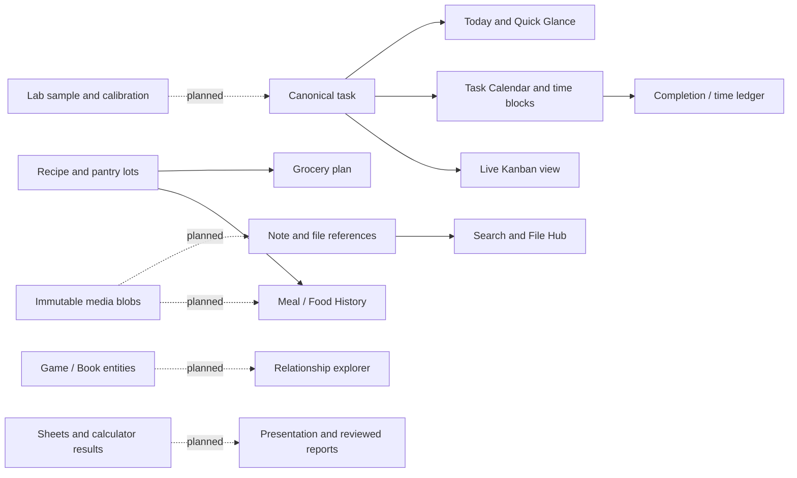

# Feature integration and shared records

Solid arrows have source or narrow test support. Dotted arrows describe proposed or incomplete connections. Full UI lifecycles are listed in [coverage](12_AUDIT_COVERAGE.md).

| Priority | Source → destination | Present behavior and gap | Canonical identity/write path |
|---|---|---|---|
| Immediate | Attachment → clean device/views | Reference sync works in independent case while bytes are missing. | Publish verified content hash with scoped download job. PF-02 |
| Immediate | Backup → client → replacement server | Broken reconciliation, see PD-003. | Versioned manifest and explicit server identity. PF-03 |
| Immediate | Task ↔ Today/Calendar/board | Shared tasks/derived blocks in source, repository scheduling/undo cases. Live board and UI edit across reload pending. | Keep task ID. Put schedule slot in typed relation. PF-09/11 |
| Immediate | Chore complete → History and room stats | Core completion history and date replay cases pass. | Ledger event generated exactly once per occurrence. PF-09 |
| Immediate | Today/Meal → Food History | Common meal/food actions in source and repository test. UI cross-view lifecycle pending. | One consumed meal event with source meal/recipe version. PF-15 |
| Near | Recipe + pantry → grocery shortage | Existing domain calculations and kitchen suite. Complete reconciliation and substitutions need UI and offline race cases. | Inventory movement references each lot, with missing quantity derived. PF-15 |
| Near | Purchase → inventory and budget | Existing order/inventory/budget screens. Full atomic receipt and cost update not verified. | One purchase ID and movement/cost rows in one write. PF-25 |
| Near | Sample → testing task/deadline/archive | Source has samples, due lists and independent lab tasks. Automatic linkage incomplete or unverified. | Typed analysis execution produces task/reminder with provenance. PF-23/34 |
| Near | Subcontract shipment → outstanding result | Lab UI has fields for follow-up. Verify record match and receipt corrections. | Stable sample/assay ID and event log. PF-23 |
| Near | Calibration → instrument history/QC chart | Existing schedule and analytical tools. Canonical history and chart integration unverified. | Calibration event references instrument and method revision. PF-24 |
| Near | Lab meeting action → task/timeline | Meeting forms and action item paths exist, closure on other views unverified. | Action references task and source meeting. PF-09/34 |
| Near | Lab price + method → client quote/report | Price and template entities exist. Quote-revision linkage and authorization need acceptance. | Pin dated price row and method version in a reviewed quote. PF-24/25 |
| Near | Task completion → estimate/capacity | Actual duration and task type analytics exist. Statistical calibration needs independent target. | Immutable duration observations with optional interruption tags. PF-11/49 |
| Near | Photo → diary, recipe, planner, albums | Reference-capable stores and views. Cross-device byte hydration missing. | One original hash, shared scoped references and independent edits. PF-02/32 |
| Near | Calculator result → sheet or report | Calculator has saved records. Direct reusable versioned result path unverified. | Typed value with units, formula version and inputs. PF-33 |
| Near | Spreadsheet chart → presentation | Planaday data-pull into sheets and slide elements exist. Direct chart/live link not established. | Versioned view reference or rendered frozen attachment. PF-40 |
| Near | Game entity → skills/equipment → balance | Game balance and fields exist. Durable references across modules need design. | Entity and scenario IDs with pinned input versions. PF-26 |
| Near | Game system → code snippet and test | Editor project and design logic exist. Shared lineage and fixture metadata unverified. | Read-only code references tied to test revision. PF-27/30/48 |
| Near | Book character → scenes/arcs/tree | Character and chapter records with appearance inference. Structured scene links remain improvement. | One appearance edge to scene and approved canon entity. PF-28 |
| Near | Whiteboard card → actual task/record | Linked cards in source. Test once refreshed and across deleted records. | Reference with scoped preview, preserve shape/placement independently. PF-09/31 |
| Mid | Document scan → searchable archive and reminder | File Hub filter and uploads present. Indexing and receipt metadata are missing. | Private content index plus typed attachment and reminder. PF-10/16 |
| Mid | Trip → calendar, packing and private media | Existing adjacent domains. Pack readiness and local times need integration. | Trip manifest with event IDs, offsets and scoped files. PF-19 |
| Mid | Workout/mood → private trends | Diary and wellness data models. Consistent units, optional joins and privacy controls pending. | Per-measure event and explicit user scope. PF-17/39 |
| Mid | Shared date → household roster | Views exist; role and profile scope are a separate security need. | Household event linked to authorized members by role. PF-04/18 |
| Long | Browse timeline → historical comparison | History reports are domain-specific. Build privacy-aware projection from scope. | Derived event index, selected time windows and pinned snapshots. PF-39/43 |

Reuse one record mutation, relation, attachment and view system for these workflows. Keep complementary specialized entry points and preserve historic snapshots alongside live links. [Expanded roadmap](21_EXPANDED_PRODUCT_ROADMAP.md)
