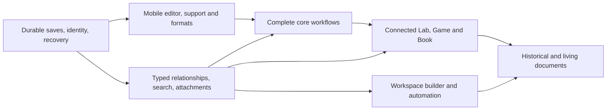

# Expanded product roadmap

This is a dependency-based proposal. Dates and scope are ownership decisions. Preserve approved requirements and existing stored data through any migration. See the separate [repair roadmap](10_PRIORITIZED_DEVELOPMENT_ROADMAP.md) for current defects, [catalog](15_COMPLETE_NEW_FEATURE_CATALOG.md) for proposals, and [provenance](23_PROPOSED_MASTER_SPECIFICATION_ADDITIONS.md) for claim and approval status.

| Milestone | Include | Prerequisites and independent acceptance |
|---|---|---|
| R0 Release and data protection | Resolve PD-001 to PD-005 first. Atomic commits, verified attachments and recovery, pairing/server changes, runner trust decisions. Adopt CI evidence gate and redacted support diagnostics. PF-01–04/47 | Consent and compatibility model. Produce two-device round trips, exact hashes and true restore/rebind. Separate security configuration acceptance. |
| R1 Focused usability and correctness | Files/mobile form fixes, Notes profiling and draft security, PWA install/offline, CSV/download/root corrections, default navigation and application health. PF-05–08/14/46 | R0 underlying save/state contracts. Physical-device and screen-reader acceptance, build cold-offline and validated exports. |
| R2 Shared services | Typed links, domain schemas, attachment ownership, query scopes, incremental search, explicit version/cursor store, shared editor/field primitives. PF-09/10/32/38 | Verify migrate old data and preserve every active ID, undo, export, filter, deleted-item policy and record link. |
| R3 Finish daily loops and existing requirements | Notes hierarchy, calendars, reliable chores/tasks, cooking + grocery, digital planner, reminders. Complete known requirement sections before selecting further breadth. PF-11/12/15/31/37/46 | R1–2 with focus on full 25-step lifecycles where applicable, filled mobile cases and real two devices. |
| R4 Prioritized owner workspaces | Lab sample and purchasing pilots, linked QC/calculations, Game versions/playtests and Book scenes/continuity. PF-23–29/33 | Auditable roles, typed links, method review, precise comparator fixtures and no accreditation claim. Prove one end-to-end workflow per area before adding more fields. |
| R5 Office, household and specialized improvements | Scoped document review, optional shared household, receipt and travel workflows, personalized education and templates. PF-16–22/38/48 | Standard file interop and offline safety. Sensitive permission and verified ownership boundaries for any sharing. |
| R6 Advanced customization, workflow rules | Implement previews, versioned templates, editor/view layout and bounded rule execution first. PF-34/36/44/45 | R2 typed records. Review permissions, dry runs, trace, undo, loop prevention and rule change migration. |
| R7 Evidence-driven innovation | Timeline, cross-feature comparisons, living docs, recovery rehearsal, consented local AI and time calibration. PF-35/39–43/49 | Require relevant R0–R6 dependencies and a narrow owner-approved pilot per concept. Keep outputs scoped; measure use before expanding. |
| R8 Product refinement | Improve responsiveness under realistic data, simplify redundant navigation, tune theme/spacing/accessibility and uninstall/upgrade paths. | Independently validate results and level of support. Maintain stable artifacts and open exports. |

## Boundaries

Adopt one mutation service, one typed link model, one blob identity and retention model, one document history and verified export interface, and one view/template definition shared across domains. Use a capability registry for desktop, browser and native devices. Keep module logic for Lab custody and calibration, book revision and game scenarios where domain meaning differs. Consolidating repeated UI and storage behavior should preserve distinct user capabilities and original records.

Small investments: accessible labels, responsive File Hub, export helper correction, clear version and support states. Medium: typed links, restore receipts, saved views and schedule proposal. Major: operational Lab lifecycle, reusable document review and scenes, attachment protocol and scope/permissions. Transformative: scoped living docs, typed workspace packs and longitudinal stats with source provenance.

Defer full IDE/engine, broad office parity, generative automation and a global marketplace pending baseline acceptance and explicit owner decisions. PF-50 compares the cost to format and tool handoff.
